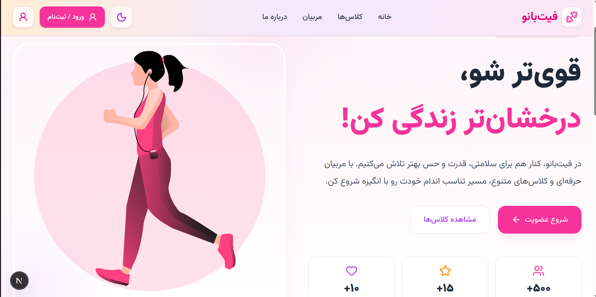
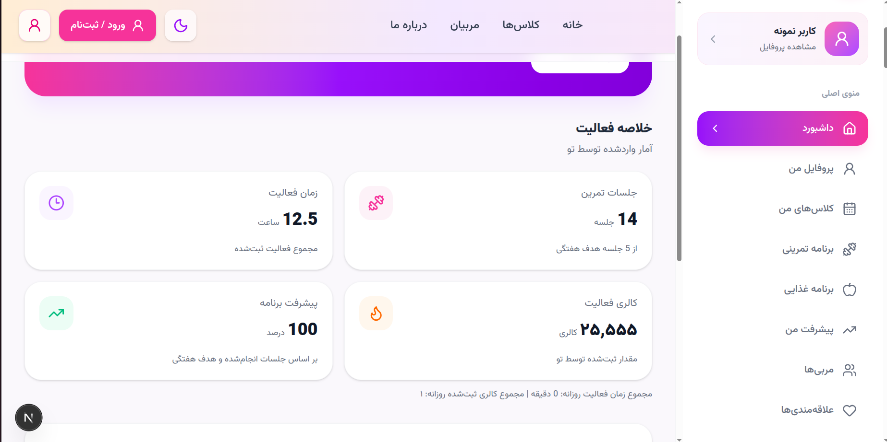

# 🏋️ FitBanoo | فیت‌بانو
## 🖥️ Project Preview

### 🏠 Homepage

<p align="center">
  
</p>

### 📊 Dashboard

<p align="center">
  
</p>
یک پلتفرم ورزشی برای مشاهده کلاس‌های ورزشی، آشنایی با مربیان و مدیریت فعالیت‌های ورزشی.

## ✨ امکانات پروژه

- 🏠 صفحه اصلی با طراحی مدرن و واکنش‌گرا
- 👩‍🏫 نمایش مربیان ورزشی
- 🏃 معرفی کلاس‌های ورزشی
- 📊 داشبورد مدیریت فعالیت‌های ورزشی
- 📈 نمایش آمار و نمودارهای فعالیت
- ✏️ امکان ویرایش اطلاعات داشبورد
- 💾 ذخیره اطلاعات داشبورد در مرورگر با LocalStorage
- 📱 طراحی واکنش‌گرا برای موبایل و دسکتاپ

## 🛠 تکنولوژی‌های استفاده‌شده

- Next.js
- React
- JavaScript
- Tailwind CSS
- Lucide React
- LocalStorage

## 🚀 اجرای پروژه

ابتدا مخزن را دریافت کن:

```bash
git clone YOUR_REPOSITORY_URL
```

و وارد پوشه پروژه شو:

```bash
cd fitbanoo
```

وابستگی‌ها را نصب کن:

```bash
npm install
```

سرور توسعه را اجرا کن:

```bash
npm run dev
```

سپس آدرس زیر را در مرورگر باز کن:

http://localhost:3000

## 📂 ساختار پروژه

```text
fitbanoo/
├── app/
│   ├── components/
│   ├── dashboard/
│   ├── api/
│   ├── layout.js
│   └── page.js
├── public/
├── package.json
└── README.md
```

## 👩‍💻 توسعه‌دهنده

این پروژه با هدف تمرین و توسعه مهارت‌های طراحی و برنامه‌نویسی وب ساخته شده است.

**Project:** FitBanoo  
**Framework:** Next.js